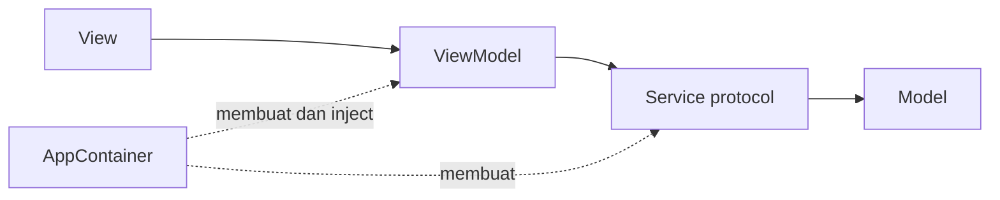
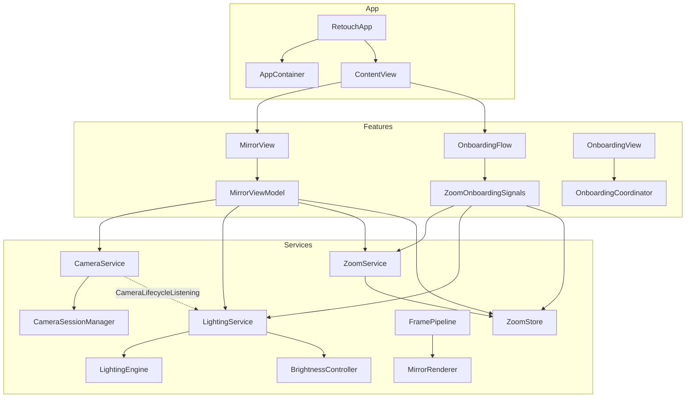
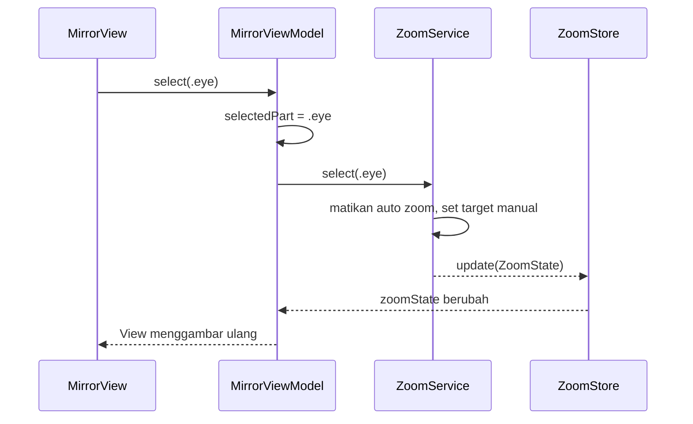
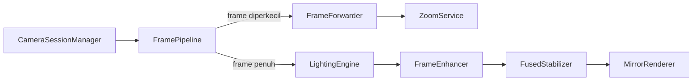
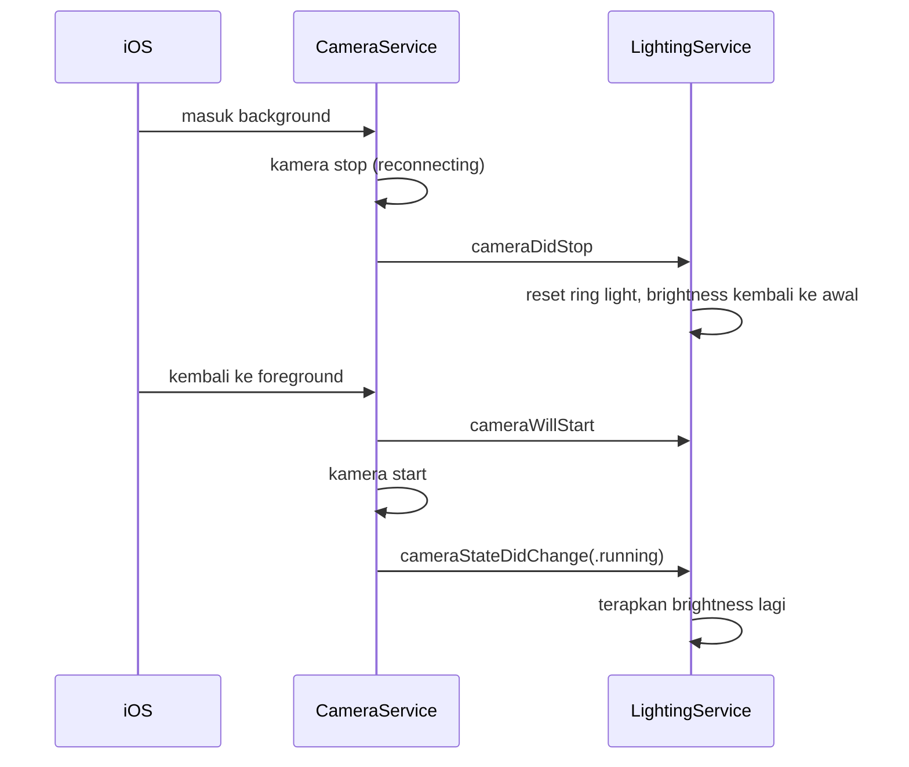

# Retouch: High Level Architecture

Dokumen ini menjelaskan bentuk arsitektur Retouch setelah restrukturisasi: lapisan, siapa memanggil siapa, urutan pemanggilan, dan alasan di balik setiap keputusan. Aturan teknis detail ada di `retouch-spec/engineering.md`, dan peta file lama ke baru ada di `MOVE_MAP.md`.

## 1. Gambaran besar

Retouch memakai MVVM dengan satu jalur pemanggilan:

| Lapisan | Tugas | Tidak boleh |
|---|---|---|
| View | Menampilkan state, meneruskan aksi user ke ViewModel | Memanggil service, membuat service, menyentuh UserDefaults |
| ViewModel | Menyimpan state layar, memanggil service lewat protocol | Membuat service, mengenal View lain |
| Service | Kamera, lighting, zoom, render | Mengenal View atau ViewModel |
| Model | Data biasa (struct, enum) | Logika UI atau service |
| AppContainer | Satu-satunya tempat membuat dan menyambung service | Berisi logika fitur |

Panah selalu satu arah. Lapisan bawah tidak pernah memanggil lapisan atas.

## 2. Komponen utama

| Komponen | Tanggung jawab |
|---|---|
| `AppContainer` | Membuat semua service sesuai urutan, menyambung frame dan hasil zoom, membuat ViewModel |
| `CameraService` | Start, stop, retry kamera, buka Settings, lifecycle app (background, foreground, active) |
| `LightingService` | Brightness layar, ring light, filter warna, mode auto atau manual |
| `FramePipeline` | Membagi setiap frame ke zoom dan ke lighting plus render |
| `ZoomService` | Deteksi wajah dan tangan, menentukan target zoom, pinch, belajar profil user |
| `ZoomStore` | Menyimpan hasil zoom di main actor supaya bisa dibaca layar |
| `MirrorViewModel` | Semua state dan aksi layar Mirror |
| `ZoomOnboardingSignals` | Mengubah hasil zoom jadi sinyal onboarding, dan menjalankan aksi kamera saat tutorial |

## 3. Urutan wiring saat app dibuka

Semua terjadi sekali di `AppContainer.init`, dengan urutan tetap:

1. `CameraSessionManager` dibuat, lalu diberi pengaturan auto frame rate dari `LightingConfig`.
2. `CameraService` dibuat dengan `CameraSessionManager`.
3. `LightingEngine` dibuat, lalu `LightingService` dibuat dengan engine dan `BrightnessController`.
4. `LightingService` didaftarkan sebagai pendengar lifecycle kamera.
5. `FramePipeline` dibuat, lalu setiap frame kamera diarahkan ke `pipeline.process`.
6. `ZoomService` dibuat, lalu hasilnya disambungkan ke `ZoomStore`, dan frame kecil dari pipeline diarahkan ke `zoom.process`.
7. `MirrorViewModel` dibuat dengan semua service di atas.

Setelah itu `RetouchApp` memberi `ContentView` dua hal: `mirrorViewModel` (satu instance seumur app) dan `makeOnboardingSignals` (factory, karena onboarding bisa diputar ulang dan setiap putaran butuh instance baru).

## 4. Urutan pemanggilan

### 4.1 Aksi user

Contoh: user memilih "Eye" di Lock Zoom.

Pola yang sama berlaku untuk lampu (`setLightMode` ke `LightingService`), pinch (`pinchChanged` ke `ZoomService`), dan tombol Settings (`openSettings` ke `CameraService`).

### 4.2 Alur frame kamera (di luar main actor)

1. Kamera mengirim frame ke `FramePipeline`.
2. Frame diperkecil ke 1280 px lalu dikirim ke `ZoomService` untuk deteksi wajah dan tangan.
3. Frame penuh diukur cahayanya oleh `LightingEngine`, diperbaiki oleh `FrameEnhancer`, distabilkan, lalu digambar oleh `MirrorRenderer`.

Semua langkah ini berjalan di luar main actor supaya UI tidak tersendat.

### 4.3 Hasil kembali ke layar

| Sumber | Jalur | Dipakai oleh |
|---|---|---|
| Zoom | `ZoomService` ke `ZoomStore` (main actor) | `MirrorViewModel.zoomState`, lalu `MirrorPreview` mengatur zoom renderer |
| Posisi wajah dan target | `ZoomService` ke `ZoomStore` lalu ke listener | `ZoomOnboardingSignals` untuk langkah tutorial |
| Cahaya | `LightingEngine` ke `LightingService` | Brightness layar dan ring light di `MirrorView` |
| Status kamera | `CameraSessionManager` ke `CameraService` | Layar izin ditolak, reconnecting, gagal |

### 4.4 Lifecycle app

`CameraService` yang menerima notifikasi iOS, lalu memberi tahu `LightingService` lewat protocol `CameraLifecycleListening`. Lighting tidak pernah memanggil `UIApplication` sendiri.

### 4.5 Onboarding

1. `ContentView` menampilkan `OnboardingFlow` di atas `MirrorView` selama onboarding belum selesai.
2. `OnboardingFlow` membuat `ZoomOnboardingSignals` dari factory, lalu menyambungnya ke `ZoomStore`.
3. Saat tutorial memilih bagian wajah atau lampu, `ZoomOnboardingSignals` meneruskannya ke `ZoomService` dan `LightingService`.
4. Saat tangan masuk ke area mata dan zoom membesar, sinyal dikirim ke `OnboardingCoordinator` untuk lanjut ke langkah berikutnya.
5. Saat selesai, zoom dan lampu dikembalikan ke auto.

Onboarding tidak memakai apa pun dari folder Mirror. Keduanya hanya berbagi service dan `ZoomStore`.

## 5. Thread dan concurrency

| Berjalan di main actor | Berjalan di luar main actor |
|---|---|
| Semua View dan ViewModel | `CameraSessionManager` (queue capture AVFoundation) |
| `AppContainer`, `CameraService`, `LightingService`, `ZoomStore` | `FramePipeline`, `LightingEngine`, `FrameEnhancer`, `MirrorRenderer` |
| | `ZoomService` dan semua detector, recognizer, flow, tracker |

Target project memakai default isolation MainActor, jadi tipe yang berat harus ditandai `nonisolated` secara eksplisit. Hasil dari luar main actor hanya masuk ke main actor lewat `ZoomStore` atau callback `LightingEngine`.

## 6. Keputusan, alasan, dan efeknya

| Keputusan | Alasan | Efek ke tim |
|---|---|---|
| `MirrorSession` dipecah jadi `AppContainer` dan `ZoomStore` | Dulu satu file membuat service, menyimpan state, dan dipakai semua fitur, jadi sering konflik | Wiring hanya di satu tempat yang append-only, state zoom punya rumah sendiri |
| `AutoLightDetector` dipecah jadi `CameraService` dan `LightingService` | Satu kelas memegang kamera, brightness, lifecycle, dan `UIApplication` | Masing-masing bisa dites dan diubah tanpa menyentuh yang lain |
| `LightingViewModel` digabung ke `MirrorViewModel` | Isinya hanya meneruskan panggilan | Satu ViewModel per layar, lebih mudah dicari |
| `ZoomGestureService` (922 baris) dipecah | Lima tanggung jawab dalam satu file | `ZoomService` untuk API, `+Frame` untuk logika per frame, `+Learning` untuk pinch dan profil, `ZoomReadiness` untuk perhitungan murni yang bisa dites |
| Service diakses lewat protocol (`CameraServicing`, `LightingServicing`, `ZoomServicing`) | ViewModel harus bisa dites tanpa kamera asli | Tes memakai fake di `RetouchTests/Fakes/` |
| Folder `ZoomGesture/` dibagi subfolder | 28 file rata dalam satu folder | Maksimal 8 file per folder, mudah ditebak tempatnya |
| Komponen global di `Components/`, komponen fitur di `Features/<Fitur>/Components/` | Aturan ini sudah dipakai tim, hanya belum tertulis | Satu pertanyaan untuk menaruh file: dipakai satu fitur atau lebih |
| Kode debug dihapus | Menambah file dan bercampur dengan produksi | Overlay debug dan log zoom tidak ada lagi di app |
| Nama folder lama dipertahankan | Tim sudah mengenalnya, mengganti semua nama hanya menambah konflik | Yang berubah adalah jalur pemanggilan dan isi file, bukan nama folder |

## 7. Batasan yang diketahui

1. `AppContainer` dan `ContentView` tetap titik konflik, karena setiap fitur atau service baru menambah baris di sana. Aturannya: append-only dan satu pemilik.
2. Properti `ZoomService` bersifat `internal` supaya bisa dipakai file extension-nya. Perilakunya sama, tapi terlihat dari seluruh modul.
3. `CameraSessionManager` masih 453 baris. Pemecahannya dijadwalkan sebagai PR terpisah.
4. Beberapa bagian lama masih memakai `DispatchQueue` (queue kamera, `ZoomService`, `LightingEngine`). Kode baru tidak boleh menambahnya.
5. Kamera, gesture, brightness, dan panas perangkat hanya bisa dicek manual di iPhone asli.

## 8. Menambah sesuatu tanpa merusak arsitektur

| Mau menambah | Tempat | Sentuhan ke file bersama |
|---|---|---|
| Layar baru | `Features/<Fitur>/Views`, `ViewModels`, `Components` | 1 factory di `AppContainer`, 1 route di `ContentView` |
| Service baru | `Services/<Domain>/` dengan protocol `<Nama>Servicing` | 1 baris di `AppContainer`, 1 fake di tes |
| Komponen UI | Folder fitur, atau `Components/` kalau dipakai 2 fitur atau lebih | Tidak ada |
| Angka tuning | `LightingConfig`, `LightingTuning`, atau `ZoomTuning` | Tulis nilai lama, baru, dan AC terkait di PR |

Langkah lengkapnya ada di `retouch-spec/playbooks/`.
